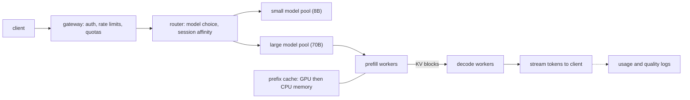

# Worked design: an LLM chat service

The prompt: *"Design the serving system for a chat assistant with a million daily users. Keep the cost per user low."* This is mostly an infrastructure design, so the numbers carry the answer. It reuses the 70B model from the serving track: 80 layers, 8 KV heads, head dimension 128, BF16 weights and KV cache, on replicas of 4 GPUs with 80 GB and 3.35 TB/s each, at $2.50 per GPU-hour.

### Clarify

- **Traffic.** 1 million daily users, 6 messages each a day, peak hour at 3× the average.
- **Shape of a message.** The prompt the model sees averages **2,000 tokens** (system prompt plus conversation history) and the reply averages **300 tokens**. Context is capped at 8,000 tokens.
- **Latency goals.** Time to first token under 1 s at p95 and at least 20 tokens per second per user while streaming (time per output token under 50 ms).
- **Quality.** The product team says the 70B model's quality is the bar for hard questions, but most messages are simple.

### Size it in tokens

- Messages: 6M a day, 69 a second on average, about **210 a second** at peak.
- Output tokens at peak: 210 × 300 ≈ **63,000 tokens a second**.
- Prompt tokens at peak: 210 × 2,000 = **420,000 tokens a second** to prefill, if nothing is cached.

### Decode capacity

From the serving track, a replica with every sequence reserved at 4,096 tokens holds 119 sequences and produces about **5,300 tokens a second** at a 22 ms step. With a paged KV cache, memory follows the real lengths (about 2,300 tokens on average), so about 210 sequences fit and a replica gives roughly **9,500 tokens a second** at the same step time, because the bytes read per step are the same.

- Without paging: 63,000 / 5,300 ≈ 12 replicas, **48 GPUs**.
- With paging: 63,000 / 9,500 ≈ 7 replicas, **28 GPUs**.

Both meet the 50 ms per-token goal at about 22 ms, so there is room to trade latency for batch if memory allowed.

### Prefill capacity

Prefill is compute-bound: about 2 × parameters FLOPs per prompt token, so 1.4 × 10¹¹ FLOPs per token for 70B. Assume 500 TFLOP/s of useful BF16 compute per GPU (roughly half of a modern accelerator's peak).

- No caching: 420,000 × 1.4 × 10¹¹ = 5.9 × 10¹⁶ FLOP/s, about **118 GPUs** of prefill. This is bigger than decode, and it is the number many candidates forget.
- **Prefix caching.** In a conversation, each turn's prompt starts with the previous turn's prompt and reply. Keep those KV blocks (in GPU memory, spilling to CPU memory) and route each conversation back to the same replica (session affinity), and only the new user message, about 250 tokens, needs prefill. The shared system prompt is cached for everyone. Prefill drops to 210 × 250 × 1.4 × 10¹¹ ≈ 7.4 × 10¹⁵ FLOP/s, about **15 GPUs**.

The lesson for the interview: in chat, conversation history makes prompts much longer than replies, and **prefix caching is the biggest single saving**, larger than any decode optimisation.

### Put it together

- **Model routing.** A small classifier or rules send simple messages (greetings, short factual questions, rewrites) to an 8B model, which costs roughly a tenth per token. If 60% of messages can go there without a quality loss you can measure, the 70B pools shrink by more than half. Measure with an offline evaluation set and side-by-side human ratings before turning it on, and let the small model escalate when unsure.
- **Prefill and decode.** At this scale, split them into separate pools (disaggregated serving) so long prefills do not stall decoding streams, or use chunked prefill on shared replicas. Either keeps time per output token steady at peak.
- **Autoscaling.** Scale on queue depth and KV-cache usage, not CPU. GPU replicas take minutes to start (loading 140 GB of weights), so keep headroom and scale ahead of the daily peak.
- **Quantisation.** FP8 weights halve the weight bytes read per step and free 70 GB per replica for KV cache. Evaluate quality first; it is often a free 1.5–2× in throughput.

### Cost per user

Provisioning the large pool for peak with paging and prefix caching: about 28 decode + 15 prefill = 43 GPUs, or 43 × 24 × $2.50 ≈ **$2,600 a day** if it ran at peak all day. Autoscaling towards the average (a third of peak) brings it under **$1,500 a day**, about **$0.0015 per daily user** before routing; routing most traffic to the small model cuts that further. Compare with the naive design: 48 decode + 118 prefill = 166 GPUs at peak, nearly **$10,000 a day**. The difference comes from three decisions you can name: paged KV cache, prefix caching with session affinity, and model routing.

### What to monitor

Time to first token and time per output token at p50/p95/p99, queue length, KV-cache utilisation and preemptions, prefix-cache hit rate, tokens per GPU-second, cost per thousand messages, and quality signals (thumbs down, regeneration rate, escalations to the large model).
