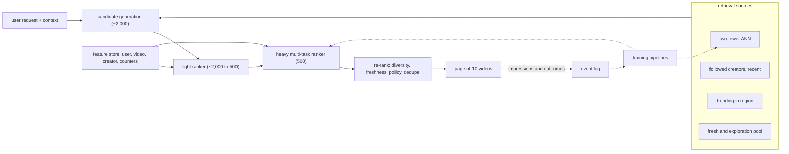

# Worked design: a short-video feed

This is how a 45-minute answer to *"Design the recommendation system for a short-video feed"* can go. Read it once for the structure, then again for the numbers. The time markers are a guide, not a script.

### Minutes 0–5: clarify and frame

Questions worth asking, and the answers we assume when the interviewer says "you decide":

- **Scale.** 50 million daily active users, each loading about 20 pages of the feed a day. The catalogue holds 100 million videos and gains 5 million a day.
- **Surface.** A full-screen vertical feed: the user sees one video at a time and swipes. So every impression gets clear implicit feedback (watch time, skip), and position bias is small after the first item.
- **Objective.** The business wants long-term engagement, not clicks. We agree on **daily watch time per user** as the north-star metric and **7-day retention** as a guardrail that must not drop. Integrity (no policy-violating videos) is a hard constraint, not a weight.
- **Latency.** The next page must be ready before the user reaches the end of the current one: a **200 ms** budget at p99 for the whole request.

Framing: for each (user, candidate video) pair, predict several outcomes (watch past 50%, like, share, follow the creator, skip within 2 seconds) and rank by a weighted combination. This is pointwise multi-task ranking, with a retrieval stage in front because no model can score 100 million videos per request.

### Minutes 5–10: size it

- Requests: 50M × 20 / 86,400 ≈ **11,600 QPS** on average, about **25,000 QPS** at peak.
- The heavy ranker scores 500 candidates per request: 25,000 × 500 = **12.5 million scorings a second** at peak. At 1 MFLOP per scoring that is 12.5 TFLOP/s, a few GPUs of pure compute, but feature fetching dominates the real cost: 500 candidates × a few hundred features each from a feature store, within ~50 ms.
- Embeddings: 100M videos × 128 dimensions × 4 bytes = **51 GB** for video vectors, which fits sharded across a few ANN servers, or on one with 8-bit quantisation (13 GB).
- Logs: 1 billion requests a day, each with ~10 impressions and their outcomes. At ~500 bytes an impression that is **5 TB a day** of training data, so training reads a sampled window, not everything.

### Minutes 10–25: the architecture

**Candidate generation.** Several sources, each cheap and each covering what the others miss. A **two-tower model** (user tower over recent watch history and context; video tower over content embeddings, creator and stats) feeds an ANN index; it captures taste but is weak on new videos. A **follow source** returns recent uploads from followed creators. A **trending source** returns what is popular in the user's region and language now. A **fresh and exploration pool** reserves slots for new uploads so they can collect their first impressions. Sources return ~2,000 candidates after deduplication and removal of seen videos.

**Light ranker.** A small model (a two-tower dot product with a few extra features, or a small GBDT) cuts 2,000 to 500 in a few milliseconds. Its job is recall of what the heavy ranker would like, so train it to imitate the heavy ranker's ordering (distillation) rather than the raw labels.

**Heavy ranker.** A multi-task network with a shared bottom and one head per outcome (or a mixture-of-experts with per-task gates when tasks conflict). Features: user (history embeddings, long-term interest clusters, device, time of day), video (content embedding, age, length, creator), cross features (has the user watched this creator? similarity to the last ten watches), and real-time counters (views and like rate in the last hour). The final score is

$$\text{score} = w_1 P(\text{watch} > 50\%) + w_2 P(\text{like}) + w_3 P(\text{share}) + w_4 P(\text{follow}) - w_5 P(\text{skip})$$

and the weights are a **product decision**, tuned with online experiments against watch time and retention, not learned from logs. Say this explicitly: it shows you know the model predicts outcomes and the business chooses the trade-off.

**Re-ranking.** Rules and a diversity pass over the top ~50: no more than two videos from one creator per page, mix topics (MMR or a sliding-window penalty on similar embeddings), boost freshness, and remove anything an integrity classifier flagged. Business rules live here, outside the model, so they can change without retraining.

### Minutes 25–35: data and training

- **Labels.** Watch fraction, like, share, follow, and fast skip, all from impression logs. Join features *as they were at serving time* (log the features the ranker saw, or do a point-in-time join), never as they are at training time.
- **Negatives.** Every impression is a labelled example, so there is no need to invent negatives for the ranker. The two-tower retrieval model does need them: use in-batch negatives with a correction for popularity (popular videos appear as negatives too often otherwise).
- **Freshness.** Tastes and trends move in hours. Train the ranker incrementally every few hours on new data, with a full retrain weekly. Real-time counters cover what the model has not yet learned.
- **Cold start.** New users: start from regional trending and onboarding choices, and adapt within the session from the first swipes (session features). New videos: content embeddings from the video, audio and caption let the two-tower model place them before any interaction; the exploration pool guarantees them some impressions.
- **Feedback loops.** The model only learns from what it showed. Keep a small exploration share (for example 1–2% of slots chosen with randomisation), log the propensity of each choice, and use it to debias training and offline evaluation.

### Minutes 35–45: evaluate, launch and monitor

- **Offline.** Per-head AUC and log loss on the next day's data, and nDCG of the combined score against watch time. Check slices: new users, new videos, small regions.
- **Online.** A/B test on user-level randomisation for at least one to two weeks (novelty effects are strong in feeds). Primary: watch time per user. Guardrails: 7-day retention, reports per thousand impressions, creator-side metrics (share of creators getting any views), latency.
- **Rollout.** Shadow traffic first (score but do not serve), then 1% → 5% → 50% with automatic rollback on guardrail breaches.
- **Monitoring.** Feature freshness and null rates, score distribution drift (PSI), calibration of each head, and latency per stage.

### Trade-offs to volunteer

| Decision | Option A | Option B | What decides it |
|---|---|---|---|
| Ranker update | Daily batch retrain | Online or hourly incremental | How fast interests and catalogue change; incremental needs strong monitoring |
| Objective | Single engagement label | Multi-task with tuned weights | Multi-task is more work but makes the trade-off explicit and tunable |
| Candidate count | Fewer, faster | More, better recall | Latency budget and the light ranker's cost per candidate |
| Exploration | None | Small randomised share | Without it, new videos and creators starve and training data is biased |
