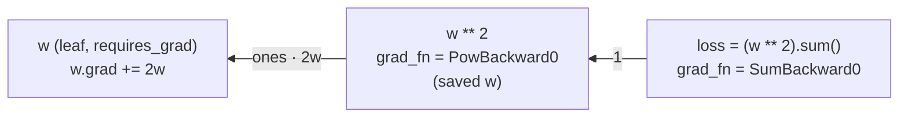

# Autograd in one page

When a tensor has `requires_grad=True`, every operation on it records a node in a graph: the operation, its inputs, and whatever it saved for the backward pass (for `y = x.sigmoid()`, it saves `y`, since $\sigma' = \sigma(1-\sigma)$). Calling `loss.backward()` walks the graph from the loss back to the leaves, applying the chain rule as **vector-Jacobian products**, and **adds** each leaf's gradient into its `.grad`.

```python
w = torch.tensor([1.0, 2.0], requires_grad=True)
loss = (w ** 2).sum()
loss.backward()
w.grad            # tensor([2., 4.])
```



*What <code>loss.backward()</code> walks. Each grad_fn multiplies the gradient flowing in by its local derivative, using what it saved in the forward pass, and leaves add into .grad.*

Five facts that interviews and debugging sessions keep coming back to:

1. **Gradients accumulate.** A second `backward()` adds to `.grad`. That is why training loops call `optimizer.zero_grad()`, and also how gradient accumulation over micro-batches works on purpose.
2. **The graph is freed after `backward()`.** Calling it twice on the same graph raises an error unless the first call passed `retain_graph=True`.
3. **`torch.no_grad()`** records nothing inside its block: use it for evaluation and for updating weights by hand. **`x.detach()`** returns a tensor sharing `x`'s data with no history: gradients stop there.
4. **In-place operations can break backward.** If an operation saved a tensor and you later modify that tensor in place, backward raises *"one of the variables needed for gradient computation has been modified by an inplace operation"*.
5. **Backward is a vector-Jacobian product.** You never build the Jacobian. For softmax $s$ with upstream gradient $g$, the input gradient is $s \odot (g - (g \cdot s))$, a few elementwise operations.

A custom operation is a `torch.autograd.Function` with a `forward` that may save tensors with `ctx.save_for_backward`, and a `backward` that receives the upstream gradient and returns one gradient per input.
