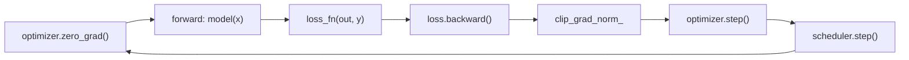

# The training loop in one page

An `nn.Module` holds **parameters** (tensors the optimizer updates, registered by assigning an `nn.Parameter` or a submodule as an attribute) and **buffers** (state that is saved but not trained, such as batch norm's running mean, registered with `register_buffer`). `model.parameters()` walks both the module and its submodules, which is why a layer kept in a plain Python list is invisible to the optimizer: use `nn.ModuleList`.

One training step, in order:

```python
model.train()                          # dropout on, batch norm uses batch statistics
for x, y in loader:
    optimizer.zero_grad(set_to_none=True)
    loss = loss_fn(model(x), y)        # forward
    loss.backward()                    # gradients into .grad
    torch.nn.utils.clip_grad_norm_(model.parameters(), 1.0)
    optimizer.step()                   # update parameters
    scheduler.step()                   # then the learning rate
```



*One training step. Skipping zero_grad accumulates gradients across steps; calling step before backward updates with stale gradients.*

For evaluation, `model.eval()` switches dropout off and makes batch norm use its running statistics, and `torch.no_grad()` (or `torch.inference_mode()`) stops recording the graph. They do different things and you usually want both.

**Optimizers keep state.** SGD with momentum keeps one buffer per parameter; Adam keeps two (the first and second moments), which is why Adam's memory is three times the parameters. **AdamW** applies weight decay directly to the weights instead of adding it to the gradient, so the decay is not rescaled by Adam's per-parameter step size.

A **checkpoint** that can resume training holds the model's `state_dict()`, the optimizer's `state_dict()` (its moments and step counts), the scheduler's state, the step number and the random number generator states. Saving only the model is enough for inference, not for resuming.
